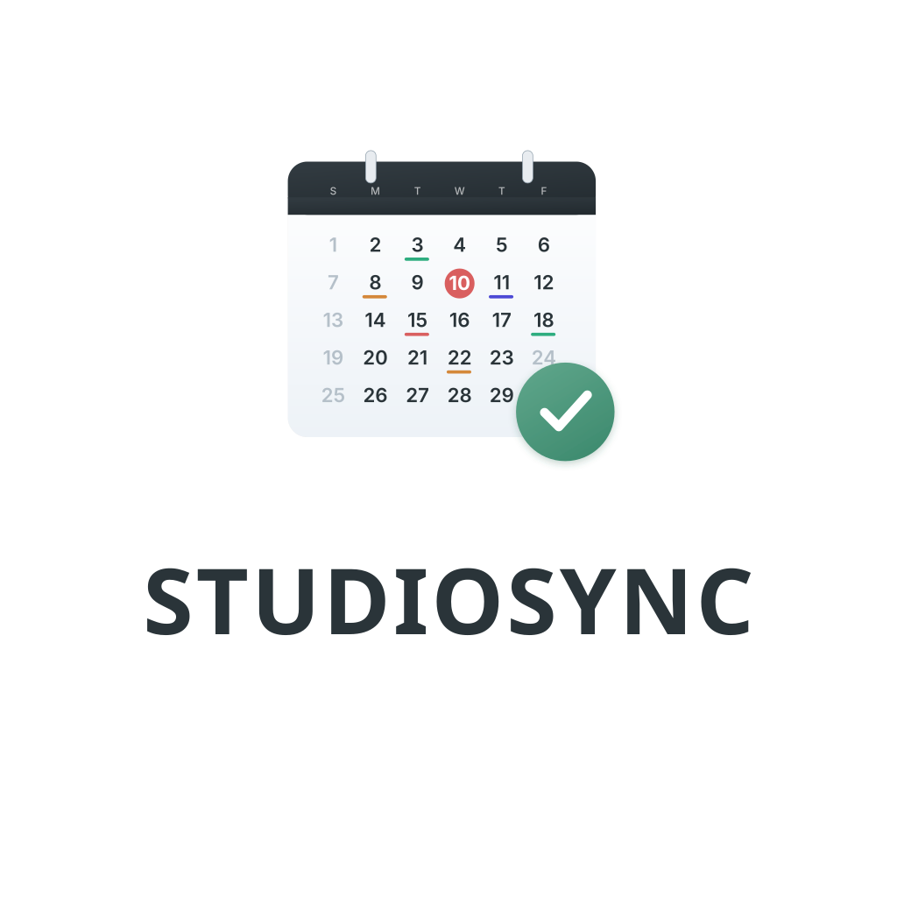
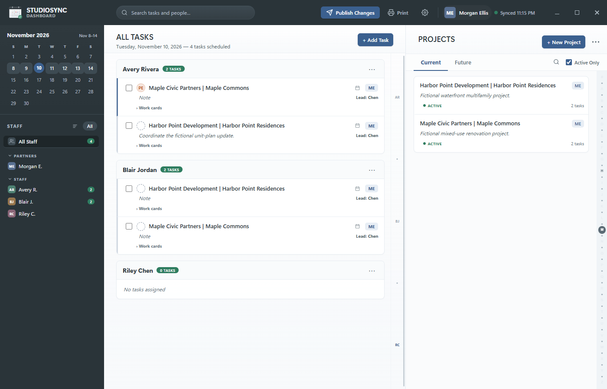
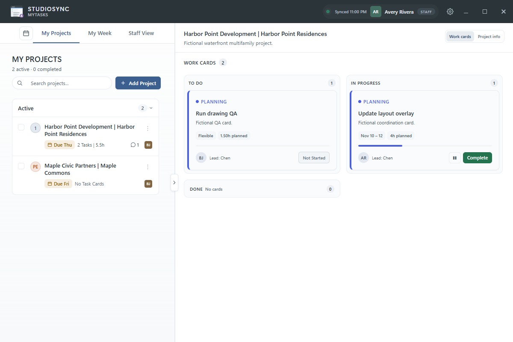
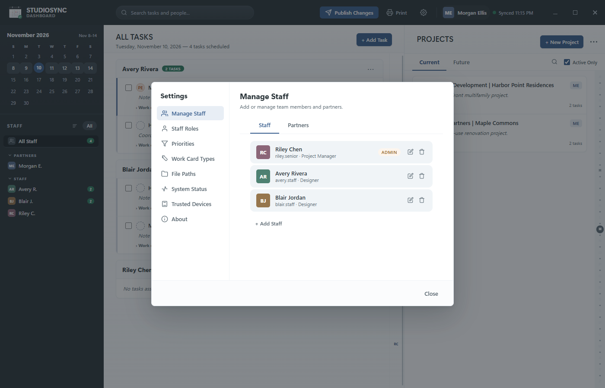
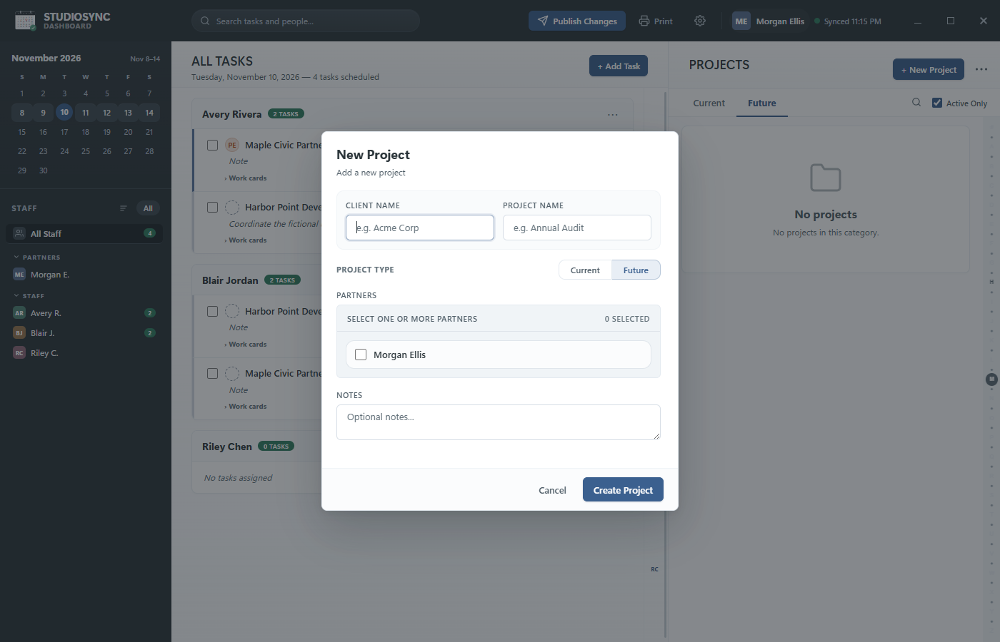
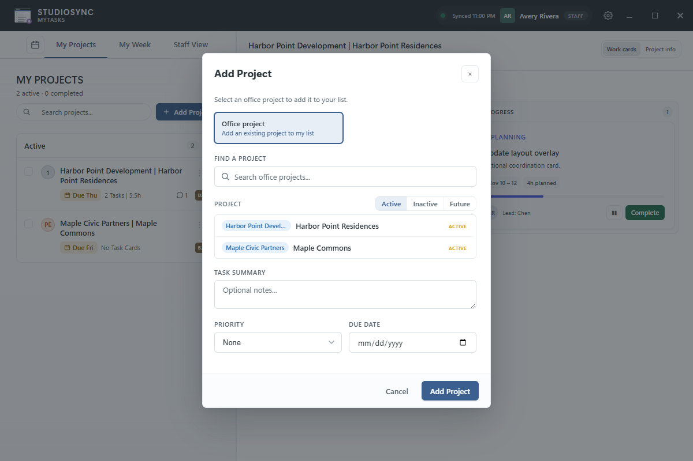
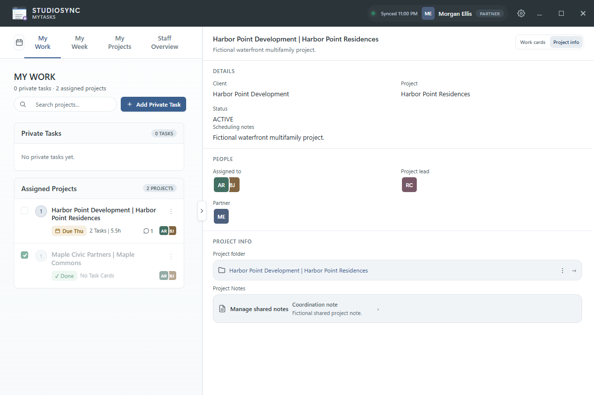

<p align="center">
  
</p>

# StudioSync

StudioSync is a two-app Windows scheduling system for small production and professional-services teams that need a clear daily board in the office and a lighter personal workspace on each desktop.

Latest public release: [v1.3.1](https://github.com/nchiappetta83/studiosync/releases/tag/v1.3.1)

- `StudioSync` is the main dashboard used to plan work, manage people, import projects, and publish office-wide updates.
- `StudioSync MyTasks` is the companion app used by partners and staff to track assigned work, add follow-up notes, and stay in sync with the main board.

Both apps are Electron-based, store data locally in SQLite, synchronize through a shared-drive event system instead of a central server database, and now keep local runtime logs for troubleshooting.

## What's new in 1.3.1

- **Work Cards** break a project's weekly work into shared cards with a type, assignees, dates, planned time and a Start / Pause / Complete workflow. Partners manage cards; assignees run them from MyTasks, and each person can mark one card as their current focus.
- Work Cards appear on the MyTasks Team Calendar by type, unfinished cards carry into the new week at the weekly rollover, and a project's lead is notified when someone else completes a card.
- **Work Card Types** are managed in Dashboard Settings, including whether each type shows on the Team Calendar. Dashboard shows a compact, read-only card list beneath a scheduled project.
- **Project Lead** is chosen on a scheduled assignment, is shared by every assignment on the project, and can only be a person marked **Senior Staff** in Dashboard Settings.
- MyTasks adds Staff Overview assignment counts, an office daily/weekly capacity setting that partners can edit, and a clearer permission for adding office projects to your own list.
- The Dashboard publishes a recovery snapshot so a new or empty MyTasks install can restore users and shared data from the shared folder. Unpublished weekly reviews can be closed with **Close & Unlock MyTasks**, and a review that is never finished expires after 12 hours.
- Sign-in uses the StudioSync profile you select rather than the Windows account, so shared and test PCs can switch profiles.
- Fixes: deleted Work Card Types no longer reappear, synced events no longer fail forever when a lead loses Senior Staff status, and avatar colours now match between the two apps.
- The release workflow now runs both smoke-test suites before building. They run on Electron's bundled runtime, so `npm test` no longer depends on the system Node version.

See the [1.3.1 release notes](docs/releases/v1.3.1.md) for details.

## What's new in 1.2.0

- A shared interaction system now keeps buttons, menus, dialogs, form controls, focus states, notifications, and destructive actions visually consistent across StudioSync and MyTasks.
- MyTasks task and project details can be opened or collapsed directly from the divider in both staff and partner workflows.
- MyTasks now exposes sync failures, retries damaged shared-drive events with backoff, and provides an explicit recovery action.
- Task completion includes immediate feedback and Undo, while saves and background actions use consistent pending, success, warning, and error states.
- Partner project editing protects unsaved changes during navigation and background refreshes.
- Keyboard navigation, modal focus management, validation, and accessible tab/menu states have been expanded throughout the apps.
- Both apps now use a single-instance desktop lifecycle to avoid duplicate background process groups.

## Product overview

### StudioSync

StudioSync is the source of truth for the office schedule. It is designed for the team member who needs to see staffing, assignments, and project load all at once.

Core capabilities:

- Create, assign, prioritize, confirm, and reorder tasks across the team
- View staff workload with task counts, PTO indicators, and drag-and-drop assignment
- Import and refresh projects from Excel, from the Projects panel's "⋯" menu
- Add new projects directly into the current or future list from the dashboard
- Manage custom priorities, business roles, and user records
- Export the schedule as PDF and HTML for office-wide visibility
- Configure a shared update folder used by both apps
- Press Ctrl+K for a command palette: type to jump to a person, project, or task, run commands such as Add Task, New Project, Print/Export, and Publish Changes, or open a Settings section. Commands you are not allowed to use are left out, and Ctrl+F still focuses the search box
- Work through task rows entirely from the keyboard: Tab to a priority chip, due date, calendar icon, or project lead and press Enter or Space; menus support the arrow keys, Home, End, and Escape (which returns focus to where you were); the date picker is a keyboard date grid (arrows, Home/End, Page Up/Down); and the Menu key or Shift+F10 opens a task's full action menu
- Run the weekly rollover flow to carry unfinished work forward cleanly with explicit Keep/Delete review actions
- Preserve custom rollover priorities while clearing only numbered weekly priorities
- Resume from the local cache on normal startup instead of rebuilding the full local database each launch
- Wait for shared sync replay and Excel refresh before opening the live dashboard so new shared or Excel-side projects are loaded first
- Start in a compact branded sign-in window before expanding into the full dashboard
- Install through a current-user installer flow that seeds the default path under `C:\SD Apps`

<p align="center">
  <br>
  <em>StudioSync Dashboard: office-wide task planning, staff workload, and project management with fictional demo data.</em>
</p>

### StudioSync MyTasks

StudioSync MyTasks is the day-to-day desktop companion. It gives users a project-first workspace for the work assigned to them, including Work Cards, due dates, and shared project context, without the admin-heavy controls of the main dashboard.

Core capabilities:

- View shared assignments synced from StudioSync, grouped by project with due-date status (Overdue, Due today, Due Thursday, Done) on each row
- Run Work Cards from a To Do / In Progress / Done board: start, pause, and complete them, and mark one card as your current focus
- Plan the week in My Week, with daily load shown against the office capacity
- Open a project's Project info for details, assigned people, the project folder, and shared Project Notes
- See the full assigned team and shared comment thread for project-linked tasks
- Open task details with Action Items and comments
- Track private partner tasks that stay local to that install
- Let partners see staff workload and assignment counts in Staff Overview, and set the office daily and weekly capacity; other staff get a read-only Staff View
- Show assigned staff avatars on partner project cards and manage those projects from a right-click menu
- Let selected staff add office projects (Active, Inactive, or Future) to their own list, and let partners add projects to the office list
- Let selected staff adjust priority on their own shared tasks
- Search projects, or staff and projects, quickly
- Choose an accent colour, a light, dark, or automatic theme, and how the details pane opens
- Detect new installers from the shared update folder
- Start in a compact branded sign-in window that mirrors the StudioSync auth flow
- Write persistent local logs for renderer and main-process issues to speed up support and diagnostics

<p align="center">
  <br>
  <em>StudioSync MyTasks: a project-first workspace with My Projects, My Week, and Staff View, plus Work Cards that assignees start, pause, and complete.</em>
</p>

## Usage flows

<p align="center">
  <br>
  <em>Manage Staff: add, edit, and organize staff and partner accounts from Settings in the Dashboard app.</em>
</p>

<p align="center">
  <br>
  <em>Add Project: create a project directly into the current or future list from the Dashboard workflow.</em>
</p>

<p align="center">
  <br>
  <em>Add Project in MyTasks: staff pick an office project to add to their own list, with an optional summary, priority, and due date.</em>
</p>

<p align="center">
  <br>
  <em>Partner project info: review project details, people, the project folder, and shared Project Notes from MyTasks.</em>
</p>

## How the apps work together

The two apps are meant to be used as a matched system:

- The main dashboard manages office-wide planning and shared data.
- Dashboard project creation follows the active Current/Future tab, and future projects can be promoted into the current list from the project menu.
- Each MyTasks install keeps a local cache and syncs changes through shared-drive event files.
- Shared tasks, Action Items, comments, project notes, and settings stay aligned across installs.
- Project-linked comments in MyTasks are shared across the staff assigned to that same project.
- Project-linked Action Items in MyTasks are shared across the staff assigned to that same project.
- Partner My Projects keeps its header fixed while the project list scrolls, matching the task-list behavior.
- Private tasks in MyTasks remain local and are never pushed back to the office schedule.

## Repository layout

```text
.
|-- sd-scheduling/    # StudioSync main dashboard
|-- sd-companion/     # StudioSync MyTasks companion app
|-- .github/workflows/
|-- docs/
|-- DESIGN.md
|-- STRUCTURE.md
`-- README.md
```

More detailed architecture and file layout notes live in [`DESIGN.md`](DESIGN.md) and [`STRUCTURE.md`](STRUCTURE.md).

## Local development

Build StudioSync:

```powershell
cd sd-scheduling
npm ci
npm run build
```

Build StudioSync MyTasks:

```powershell
cd sd-companion
npm ci
npm run build
```

## Logs and diagnostics

Both apps now keep local runtime logs to make troubleshooting easier.

- StudioSync logs: `sd-scheduling/data/logs`
- StudioSync MyTasks logs: `sd-companion/data/logs`
- StudioSync input diagnostics: `sd-scheduling/data/diagnostics/dashboard-input-diagnostics.log`

For installed builds, the same structure is kept inside each app's sibling `... Data` folder next to the installed executable.

## GitHub releases

GitHub Actions is configured in [`.github/workflows/release-signpath.yml`](.github/workflows/release-signpath.yml) to:

1. build both Windows installers on GitHub-hosted runners
2. upload the unsigned installers as workflow artifacts
3. package both `win-unpacked` folders as zip downloads
4. publish the unsigned installers and win-unpacked zip packages to the GitHub release for version tags

Both apps' smoke tests (`npm test` in `sd-scheduling` and `sd-companion`) run first, and a failing suite stops the release.

Push a tag like `v1.3.1` to publish the current unsigned release assets. Version-specific notes under `docs/releases/` are used when present; otherwise GitHub generates notes automatically. Keep the SignPath setup notes below if you want to restore signed releases later.

The interactive installers currently force current-user install mode and seed default locations under `C:\SD Apps\StudioSync` and `C:\SD Apps\StudioSync MyTasks`.

## SignPath setup

Setup details for restoring signed releases later are documented in [`docs/signpath-setup.md`](docs/signpath-setup.md).

## Screenshot note

The screenshots in this README use fictional demo users, project names, comments, and notes created specifically for documentation.
